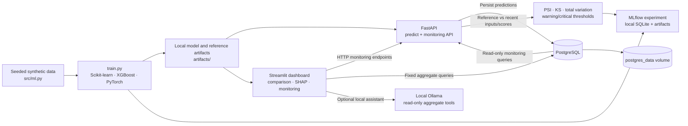

# Enterprise AI Decision Intelligence Platform

A portfolio project demonstrating a complete synthetic customer-churn ML lifecycle: model comparison, local experiment tracking, explainability, API inference, PostgreSQL persistence, and statistical drift monitoring.

> **Responsible use:** Every customer, label, and transaction in this project is synthetic. Holdout metrics describe only a reproducible synthetic-data experiment. They are not evidence of production performance, customer behavior, or causal effects.

## What this project demonstrates

- Train and compare Scikit-learn Logistic Regression, XGBoost, and a CPU-only PyTorch MLP on the same stratified holdout.
- Track models and evaluation artifacts in a local MLflow experiment.
- Explain XGBoost predictions with SHAP.
- Serve validated predictions with FastAPI and optionally persist them to PostgreSQL.
- Monitor numeric and categorical input drift, prediction-probability drift, and predicted-class distribution drift.
- Visualize model metrics, drift alerts, and recent persisted prediction activity in Streamlit.
- Provide read-only business analytics tools through LangChain and an optional local Ollama model.
- Run the services locally with Docker Compose and persistent PostgreSQL storage.

## Architecture



In Compose, PostgreSQL, the API, and dashboard communicate over the private Compose network. By default, the PostgreSQL, API, and dashboard ports bind to loopback on the host. The API applies Alembic migrations and loads deterministic synthetic customers before it starts. The named database volume survives ordinary container restarts.

## Technology

| Area | Components |
|---|---|
| Data and training | Python, NumPy, pandas, Scikit-learn, XGBoost, CPU PyTorch |
| Explainability and tracking | SHAP, MLflow |
| Serving and storage | FastAPI, Pydantic, SQLAlchemy, Alembic, PostgreSQL |
| Monitoring | Population Stability Index (PSI), Kolmogorov–Smirnov test, total-variation distance, chi-square test |
| Dashboard and assistant | Streamlit, LangChain, optional local Ollama |
| Delivery and quality | Docker Compose, pytest, Ruff, GitHub Actions |

## Synthetic model comparison

The committed source code creates reproducible fictional records with seed `42`; the saved comparison evaluates all three models on the same stratified 25% holdout (500 rows: 194 positive and 306 negative labels). The values below are read from the generated `artifacts/comparison_metrics.json` for the currently available model artifacts.

| Model | ROC-AUC | Average precision | Precision | Recall | F1 |
|---|---:|---:|---:|---:|---:|
| Logistic Regression | 0.805 | 0.724 | 0.685 | 0.582 | 0.630 |
| XGBoost | 0.771 | 0.669 | 0.629 | 0.567 | 0.596 |
| PyTorch MLP | 0.801 | 0.716 | 0.706 | 0.593 | 0.644 |

These are synthetic holdout results, not production metrics. They may change when training is repeated with different package versions or implementation settings. SHAP values explain model outputs; they do not establish causes.

## Monitoring

`src/monitoring.py` compares a stable reference dataset—the synthetic training dataset saved by `train.py`—with a current batch or recent persisted prediction inputs:

- **Numeric input drift:** PSI with bins derived from the reference distribution; a two-sample KS p-value is also reported. Missing-value rate changes are tracked.
- **Categorical input drift:** total-variation distance between category distributions and a chi-square p-value. Categorical columns are supported even though the current model inputs are numeric.
- **Prediction drift:** PSI for model probabilities and total-variation distance for predicted classes at the API's 0.5 decision threshold.
- **Alert statuses:** `ok`, `warning`, `critical`, and `insufficient_data`. The default minimum is 30 rows per comparison. Default warning/critical thresholds are 0.1/0.2 for PSI and categorical total variation. The thresholds are configurable via environment variables.
- **Performance degradation:** shown separately as `not_measured` when verified current outcome labels are unavailable. Drift alone is not evidence that model quality has changed. Stored holdout results remain labeled as synthetic training-holdout metrics.

Run a repeatable, intentionally shifted synthetic batch from the project directory:

```powershell
python -m src.monitoring_cli --shift-feature recency_days --shift-amount 60 --no-mlflow
```

By default, the command reads `artifacts/synthetic_customers.csv`, generates 500 current synthetic rows using seed `2026`, and writes `artifacts/monitoring_report.json`. Remove `--no-mlflow` to log summary metrics and the JSON report as a new run in the existing `enterprise-ai-decision-intelligence` MLflow experiment. To monitor a prepared CSV batch, add `--current path\to\current_batch.csv`. The CLI logs aggregate results only, not the current batch's rows.

Configure alert cutoffs in `.env` or the process environment:

```dotenv
MONITORING_PSI_WARNING_THRESHOLD=0.1
MONITORING_PSI_CRITICAL_THRESHOLD=0.2
MONITORING_CATEGORICAL_WARNING_THRESHOLD=0.1
MONITORING_CATEGORICAL_CRITICAL_THRESHOLD=0.2
MONITORING_MIN_SAMPLES=30
MONITORING_PERFORMANCE_WARNING_DROP_THRESHOLD=0.1
MONITORING_PERFORMANCE_CRITICAL_DROP_THRESHOLD=0.2
```

The read-only API endpoints are `GET /monitoring/summary?limit=1000` and `GET /monitoring/predictions?limit=50`. They use persisted prediction features and scores, omit customer identifiers and input feature values from the recent-activity endpoint, and return 503 when database-backed monitoring is disabled. `limit` is bounded. The dashboard identifies reference/current windows and labels holdout metrics as non-production.

The CLI can additionally evaluate a user-supplied CSV containing a binary `churned` label by passing `--evaluate-current-labels` with `--current`. It compares current ROC-AUC, average precision, and F1 to the saved synthetic holdout metrics and applies separate performance-drop thresholds. Label provenance is not independently verified; this option does not establish production performance.

## Quick start

### Local Python workflow (Windows PowerShell)

The Windows path to this project may exceed dependency/tool path limits. A short drive mapping avoids the issue:

```powershell
$project = (Get-Location).Path
subst R: $project
Set-Location R:\
py -3.14 -m venv .venv
.\.venv\Scripts\python.exe -m pip install -r requirements-dev.txt
.\.venv\Scripts\python.exe train.py
.\.venv\Scripts\python.exe -m src.monitoring_cli --shift-feature recency_days --shift-amount 60 --no-mlflow
.\.venv\Scripts\python.exe -m pytest -q
Set-Location $project
subst R: /d
```

Training creates local files in the ignored `artifacts/` directory and logs a run to local `mlflow.db`/`mlruns`. Those generated models, datasets, and tracking databases are not source-control inputs.

### Docker Compose

Train the models first so that the local `artifacts/` directory exists. Copy `.env.example` to `.env`, replace the local example password, and use that same password in `POSTGRES_PASSWORD` and `DATABASE_URL`. Keep `.env` private; never use production credentials for this demo.

```powershell
Copy-Item .env.example .env
# Edit .env locally; do not commit it.
docker compose config --quiet
docker compose up --build -d --wait --wait-timeout 300
docker compose ps
```

Open the dashboard at <http://127.0.0.1:8501>, API docs at <http://127.0.0.1:8000/docs>, or check <http://127.0.0.1:8000/health>. Set `POSTGRES_PORT` if host port 5432 is occupied. `POSTGRES_BIND_ADDRESS` and `APP_BIND_ADDRESS` default to `127.0.0.1`; do not bind these demo services to public interfaces without adding appropriate authentication and network controls.

To stop services while retaining data, use `docker compose down` (or `docker compose stop`). **Do not use `docker compose down -v` unless you intentionally want to erase the local database.**

## API example

```powershell
$body = @{
    model_name = "xgboost"
    features = @{
        recency_days = 45
        orders_90d = 3
        total_spend = 250.0
        support_tickets = 1
    }
} | ConvertTo-Json

Invoke-RestMethod -Uri "http://127.0.0.1:8000/predict" `
    -Method Post -ContentType "application/json" -Body $body
Invoke-RestMethod -Uri "http://127.0.0.1:8000/monitoring/summary"
```

The prediction response remains `prediction`, `churn_probability`, `model_name`, and `model_version`. Prediction persistence is enabled in Compose and optional for local API runs.

## Automated quality checks

The GitHub Actions workflow runs Python 3.14 with a PostgreSQL 17 service. It installs `requirements-dev.txt`, runs Ruff on the changed Python surfaces, checks dependencies with `pip check`, compiles the Python sources, and executes the tests with the PostgreSQL smoke test enabled. To run locally:

```powershell
python -m ruff check --select E4,E7,E9,F app.py src/api/main.py src/database/monitoring.py src/monitoring.py src/monitoring_cli.py tests/test_monitoring.py
python -m pip check
python -m compileall -q src tests train.py app.py
python -m pytest -q
```

For the PostgreSQL integration test, set `POSTGRES_TEST_URL` to a test database. Do not point tests at a database containing data you need to preserve.

## Demonstration walkthrough

1. Explain that the project uses seeded synthetic churn data and show the shared holdout protocol and saved comparison metrics.
2. Show MLflow's training run and the model/data artifacts; explain that tracking is local.
3. Open the dashboard and compare the three models, inspect the XGBoost SHAP explanation, and review the monitoring section's reference/current windows.
4. Call `/predict` for each model, show the stable response contract, then show that the API persisted the predictions.
5. Run the monitoring CLI with a deliberate `recency_days` shift. Explain the PSI/TVD thresholds, minimum sample status, and distinction between input drift, prediction drift, and model performance.
6. Point out that performance degradation cannot be established without verified labeled outcomes from a current production period.
7. Optionally demonstrate the LangChain assistant using local Ollama. Its tools are limited to fixed aggregates; it cannot execute arbitrary SQL or access production data.

## Limitations and responsible use

- All records and churn labels are synthetic. Metrics are not real-world validation and should not guide decisions about actual customers.
- There are no verified, labeled production outcomes. Production performance degradation is not measured.
- Drift thresholds are configurable demo defaults, not statistically calibrated operational SLOs; a real deployment needs representative baselines, sample-size policies, alert routing, access controls, and monitoring governance.
- The database and API demo are local-development services, not a hardened public deployment. Add authentication, TLS, secret management, network policy, retention controls, and operational backups before exposing any service.
- The optional Ollama assistant was tested with mocked tools, not a live model response in the previous runtime verification. LLM answers may be wrong; verify them and do not use them for consequential decisions.
- Only trusted model artifacts should be loaded; `joblib` and PyTorch model files are executable serialization formats.
- MLflow uses a local SQLite tracking store in the default workflow; it is not configured for production-scale concurrent tracking.

## Repository publication

Suggested GitHub repository: [`mannsinha1902/enterprise-ai-decision-intelligence-platform`](https://github.com/mannsinha1902/enterprise-ai-decision-intelligence-platform). Generated artifacts, local datasets, virtual environments, `.env`, and MLflow/SQLite databases are ignored. Review the final secret and size scan before adding a remote or pushing; this project does not create a remote repository or publish code.

Suggested commit sequence:

1. `feat: add statistical model drift monitoring`
2. `feat: expose monitoring API and dashboard`
3. `ci: add lint, dependency, and PostgreSQL checks`
4. `docs: document platform monitoring and limitations`

## Resume-ready description

Built a synthetic-data churn decision platform comparing Scikit-learn, XGBoost, and CPU PyTorch models; served predictions with FastAPI and PostgreSQL persistence; tracked experiments with MLflow; added SHAP explanations and PSI/KS/total-variation drift monitoring with a Streamlit dashboard and automated CI checks.
