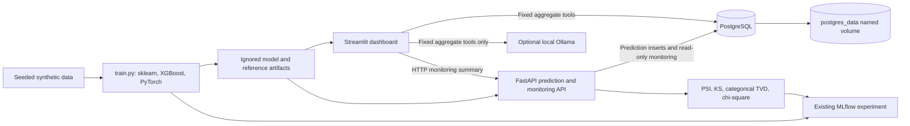

# Architecture: local ML decision and monitoring platform

All records are generated by the project's synthetic churn-data pipeline. The database loader accepts no customer-data file or row payload; it calls the seeded `make_data()` generator directly. It derives deterministic transaction rows by distributing each synthetic customer's total spend across the generated `orders_90d` count; these are illustrative records, not source-system transactions.

## Components and request flow

The normal Windows virtual-environment workflow is unchanged. For local database use, apply the Alembic migration and load synthetic records explicitly. In Compose, the API waits for PostgreSQL, runs the same migration and idempotent loader, then serves the API. The dashboard waits for a healthy API and database. Both application containers mount the locally generated `artifacts/` directory read-only. Host-published database and application ports bind to loopback by default.

MLflow remains local to the host: `train.py` writes to `mlflow.db` and `mlruns`. The Compose API reads the existing artifact metadata/run ID but does not connect to MLflow or replace its tracking store with PostgreSQL.

## Relational schema

| Table | Primary key | Relationships and notable indexes |
|---|---|---|
| `customers` | `customer_id` | Synthetic feature fields and churn label; indexes on recency and churn label. |
| `transactions` | `transaction_id` | Required FK to customer with `ON DELETE CASCADE`; indexes on customer and occurrence timestamp. |
| `model_metadata` | (`model_name`, `model_version`) | JSON metadata for each loaded saved model/version and creation/load timestamps. |
| `model_predictions` | `prediction_id` | Optional FK to customer with `ON DELETE SET NULL`; model/version and prediction timestamps indexed. Stores input features, class label, probability, model name, and version. |

All tables have explicit creation timestamps; customers also track `updated_at`. Database constraints protect nonnegative feature/spend values, the allowed recency range, prediction labels, and probability bounds. Alembic revision `0001_initial` owns the schema; application startup does not create tables implicitly.

## Analytics and LLM safety

`src/database/analytics.py` issues fixed SQLAlchemy aggregate expressions for customer totals, recency-band churn, and transaction totals. When `DATABASE_URL` is set, the LangChain tool layer uses these aggregate functions; otherwise the existing customer/recency tools continue to read the generated CSV. Model comparison continues to read the generated holdout metrics JSON. The agent has no generic SQL, shell, Python, or write-capable tool.

`PERSIST_PREDICTIONS` defaults to false. When enabled, FastAPI writes the features and result after prediction; persistence failures return HTTP 503 rather than silently dropping a record. The prediction response JSON remains unchanged. Model metadata is upserted on startup when artifacts carry an MLflow run ID.

## Model monitoring

`src/monitoring.py` compares the training-generated `synthetic_customers.csv` reference with a current batch or recent database-backed prediction activity. Numeric features use reference-quantile-binned PSI and a two-sample KS p-value; categorical features use total-variation distance and a chi-square p-value. Prediction distributions use probability PSI and class total variation at the 0.5 decision threshold. Alert cutoffs and minimum sample size are configurable through the `MONITORING_*` environment variables; defaults are warning/critical 0.1/0.2 and 30 observations.

`src/monitoring_cli.py` creates repeatable synthetic batches, supports explicit feature shifts for demonstrations, and logs aggregate statistics plus a report artifact to the existing MLflow experiment. It does not log the batch rows. FastAPI exposes bounded, read-only `/monitoring/summary` and `/monitoring/predictions` endpoints. The latter omits customer identifiers and input features. The dashboard shows drift windows, metrics, and prediction activity; small windows are labeled `insufficient_data`.

The monitoring report explicitly separates data drift, prediction drift, and performance degradation. Current persisted predictions have no verified ground-truth outcomes, so production performance status is `not_measured`. The CLI can compare an explicitly supplied labeled CSV with saved synthetic holdout metrics, but labels are not independently verified and are not described as production evidence. Saved metrics are the synthetic training holdout results and are not presented as production metrics.

## Windows and container paths

Docker Desktop is expected to use its WSL2 backend. For this workspace's Windows long-path constraint, install dependencies, train artifacts, and run Compose from a short `R:\` `subst` mapping. Compose bind-mounts the workspace's `artifacts/` directory into `/app/artifacts`; Docker Desktop must be allowed to share the backing drive. `postgres_data` is a Docker-managed named volume and survives `docker compose down`.

The Ollama endpoint defaults to host-run `http://host.docker.internal:11434` for the dashboard container. Ollama must be installed and running on Windows, and its listener/Windows Firewall must permit only the intended local Docker-to-host traffic. The normal host-run dashboard keeps its default loopback endpoint unless `OLLAMA_BASE_URL` is overridden.

## Validation boundaries

Milestone 7 was runtime-verified on Windows with Docker Engine 29.8.2, Docker Compose 5.5.1, and the WSL2 backend. Compose validation and both application image builds succeeded; PostgreSQL, FastAPI, and Streamlit reached healthy status. Alembic applied revision `0001_initial`; repeated loader runs reported 2,000 customers and 7,975 transactions without duplicates. After restarting services without removing `postgres_data`, PostgreSQL retained its customer, transaction, prediction, and model metadata rows.

Milestone 8 adds automated drift/API tests and quality checks. Run Windows commands from the short `R:\` mapping when necessary to avoid the workspace's long-path issue. Live Ollama model inference remains unverified and requires a separately installed local Ollama service.
